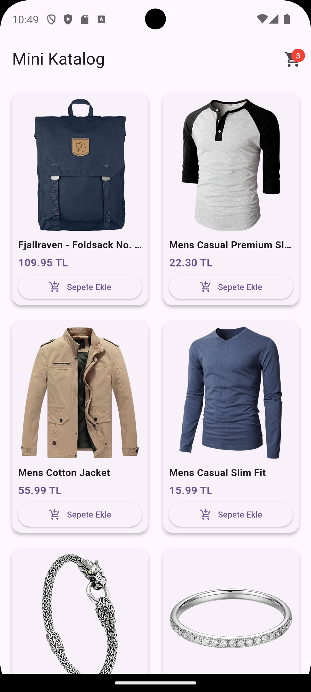
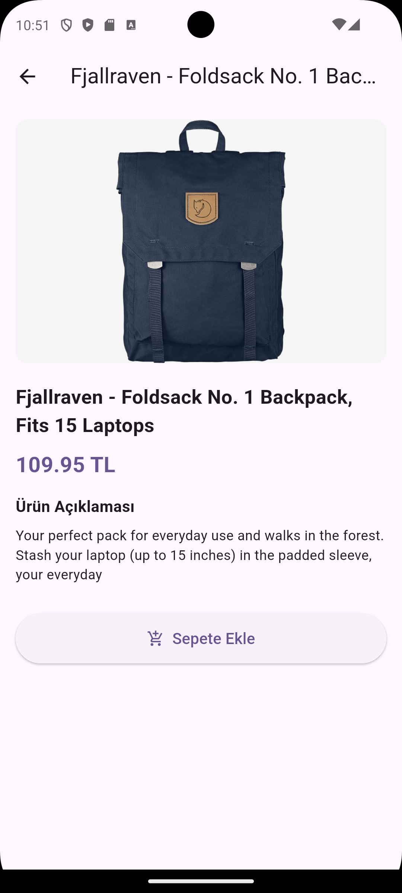
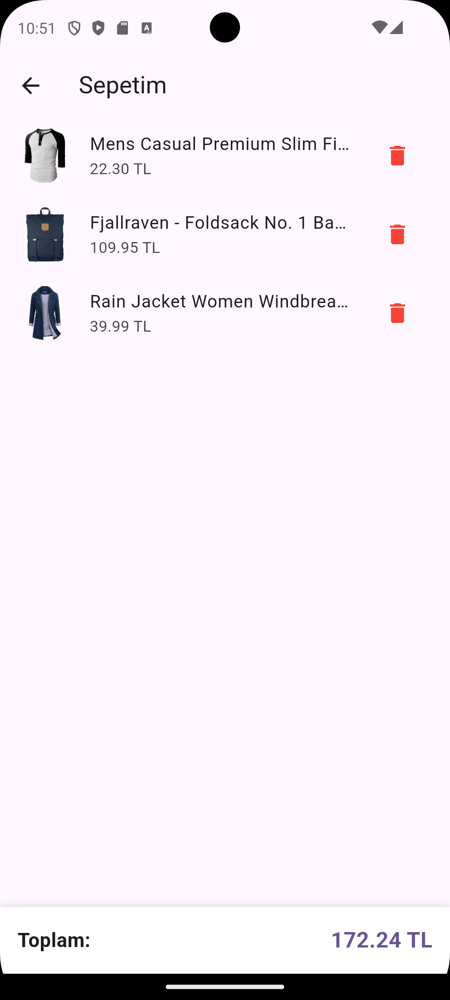

# 🛒 Mini Katalog Uygulaması

Staj bitirme projesi kapsamında Flutter kullanılarak geliştirilmiş mobil katalog ve sepet yönetimi uygulaması.

## 📌 Proje Hakkında

Bu uygulama, harici hiçbir üçüncü taraf paket (`http`, `provider` vb.) kullanılmadan, tamamen Flutter'ın kendi `dart:io` ve `material.dart` kütüphaneleri ile geliştirilmiştir. REST API üzerinden ürün verilerini çekip 2 sütunlu bir ızgara (GridView) üzerinde listeler, detay ekranı sunar ve temel state yönetimi ile sepet işlemlerini gerçekleştirir.

## ✨ Özellikler

- **Dinamik Veri Çekme:** `fakestoreapi.com` üzerindeki REST API'den `HttpClient` kullanılarak canlı ürün verilerinin çekilmesi.
- **Izgara (GridView) Listeleme:** Ürün görselleri, başlıkları, fiyatları ve sepete ekle butonları ile 2 sütunlu düzen.
- **Ürün Detay Sayfası:** Seçilen ürünün büyük görselini, tam açıklamasını ve fiyatını gösteren detay ekranı.
- **Sepet Yönetimi:** Sepete ürün ekleme, AppBar üzerinde sepet rozeti (badge) ile ürün sayısı takibi, sepetten ürün çıkarma ve toplam fiyat hesaplama.
- **Temiz Mimarisi:** Model, ekran (screens) ve bileşenlerin (widgets) modüler olarak ayrıldığı katmanlı yapı.

## 📁 Proje Mimarisi

lib/
├── models/
│   └── product.dart               # JSON verilerini Dart objesine dönüştüren model
├── screens/
│   ├── home_screen.dart           # Ana katalog ekranı ve API istek yönetimi
│   ├── product_detail_screen.dart # Ürün detay ekranı
│   └── cart_screen.dart           # Sepet ve toplam tutar ekranı
├── widgets/
│   └── product_card.dart          # GridView içinde kullanılan ürün kartı bileşeni
└── main.dart                      # Uygulama giriş noktası ve genel tema ayarları

## 🛠️ Kurulum ve Çalıştırma

1. **Projeyi klonlayın:**
   git clone https://github.com/hakan-ilhan/mini_katalog_app.git

2. **Proje dizinine geçin:**
   cd mini_katalog_app

3. **Paket bağımlılıklarını güncelleyin:**
   flutter pub get

4. **Uygulamayı çalıştırın:**
   flutter run

## 📸 Ekran Görüntüleri

| Ana Katalog Ekranı | Ürün Detay Ekranı | Sepet Ekranı |
| :---: | :---: | :---: |
|  |  |  |